<div align="center">

# Accel Udyam Digital

**A small business gets connected in one conversation, in its own language.**

Voice-first AI advisor · rules decide every price · Smart KYC in minutes · live tracker · Local Accel Experts

YTL Hackathon 2026 · Enterprise Track A (Airtel SYNC) · Team Ace

**Live demo: [accel.jayantb.dev](https://accel.jayantb.dev)**

<sub>All data is synthetic and Accel Telecom is fictional (from the case). DigiLocker, e-sign and UPI are simulated.</sub>

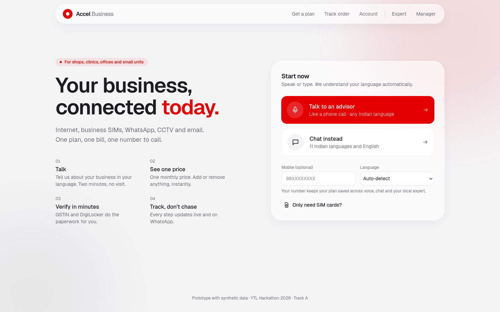

</div>

---

## The problem (from the case data)

Of **5,000** small-business leads, only **368 (7.4%)** were activated. Owners waited **17.6 days** on average, made **3 follow-up calls** per order, and dropped out over paperwork, slow quotes and unreachable salespeople. Replaying the 368 activations through the product rules shows **53 rule-breaking line items** and **22 sales on cancelled or suspended GSTINs**.

## What we built

| Step | What the owner (or staff) sees | Why it matters |
|---|---|---|
| **1. Advisor** | Talk like a phone call or chat, in 11 Indian languages + English. The plan builds live. | No salesperson needed to understand needs |
| **2. Quote** | One monthly price, 12/24 months, add-ons, "too expensive?" cheaper options | Price is decided by rules, not by the AI |
| **3. Smart KYC** | Consent first, GSTIN registry check, DigiLocker, upload only what's missing | Catches tampered or mismatched documents in seconds |
| **4. Tracker** | Every install step live, WhatsApp-style updates, auto-escalation when late | Zero status-chase calls |
| **5. Account** | Plan, add-ons, support, privacy center (download / delete my data) | DPDP rights in one place |
| **6. Expert** | Leads the AI couldn't close, with reason, model score and draft bundle | Humans only where they add value |
| **7. Manager** | Overview dashboard, rare discount approvals (3 cases, max 15%), overrides | Discounts controlled, not negotiated |

### The core idea: AI talks, rules decide

The language model only **listens and phrases replies**. Every product, eligibility rule and rupee comes from a deterministic engine over `product_catalogue.csv` (`src/lib/engine.ts`). A reply guard rejects any number or promise the engine didn't produce. So the price the owner hears is the price on the bill.

---

## Screenshots

### Advisor (chat) — the plan builds as the owner talks
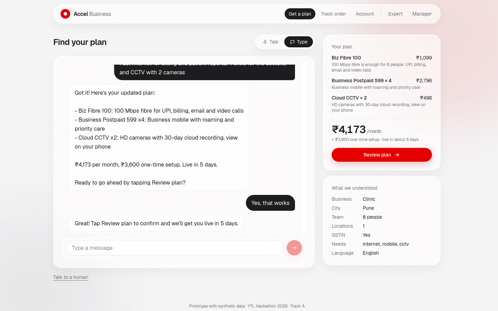

### Voice mode — like a phone call, any Indian language, interruptible
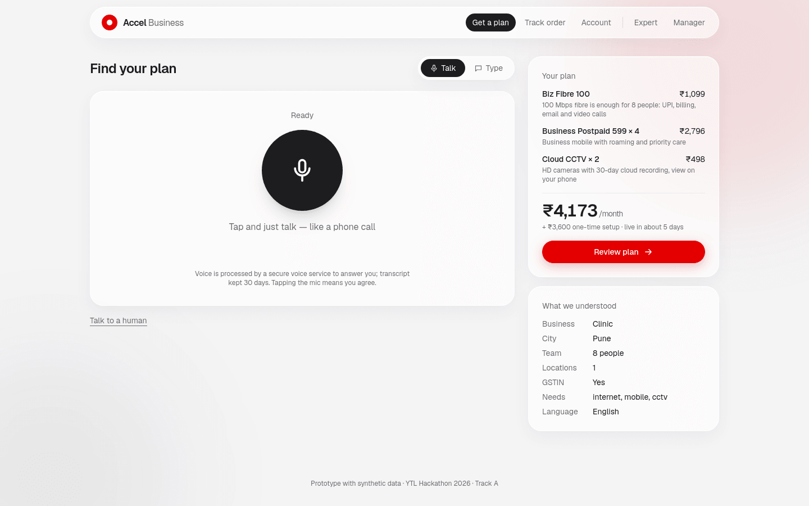

### Quote — one price, every line rule-checked
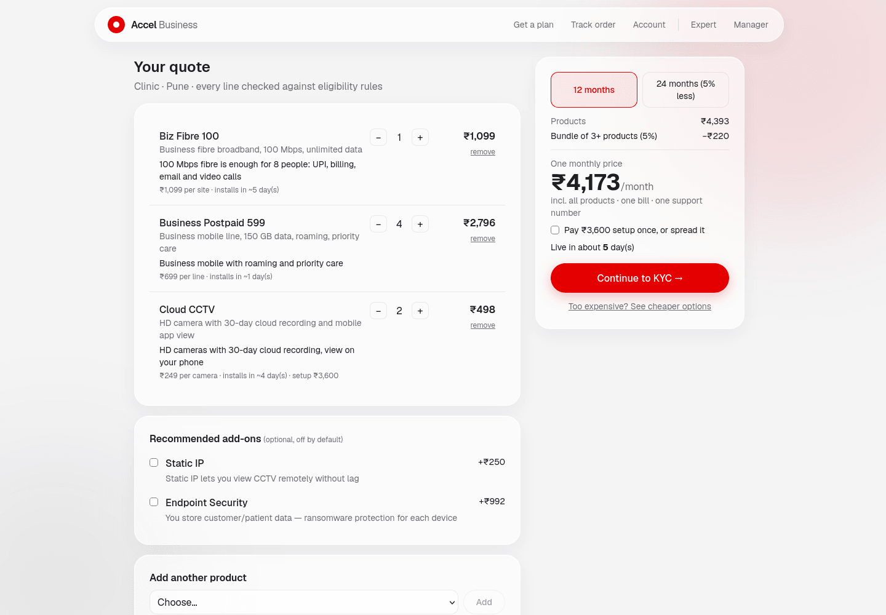

### Smart KYC — a genuine business vs a tampered certificate

| Verified (specimen K02) | Blocked: altered GSTIN (specimen K06) |
|---|---|
| 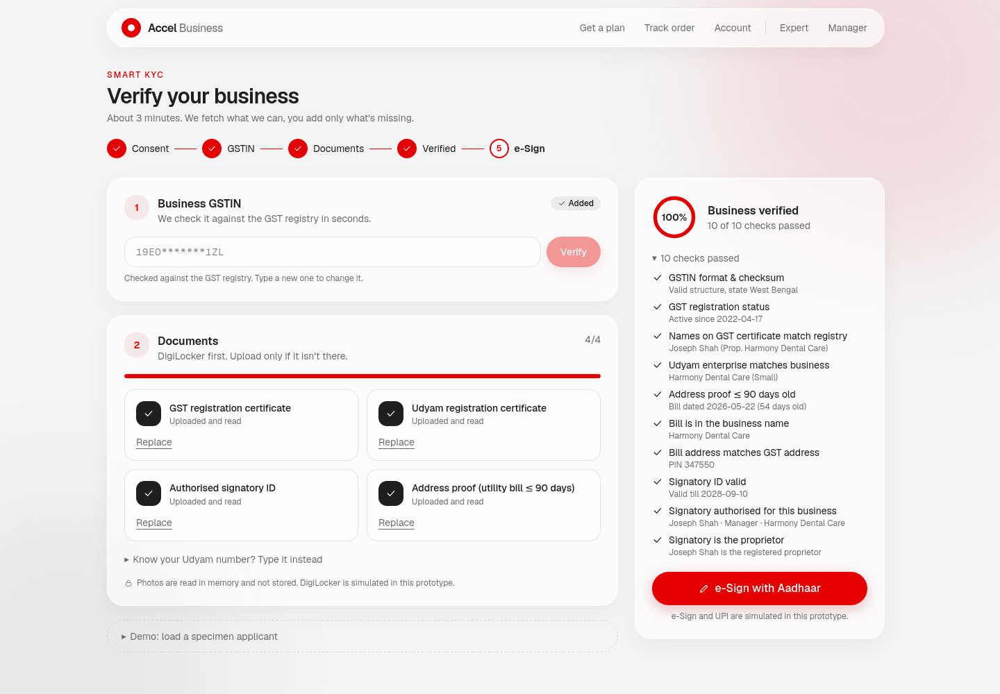 | 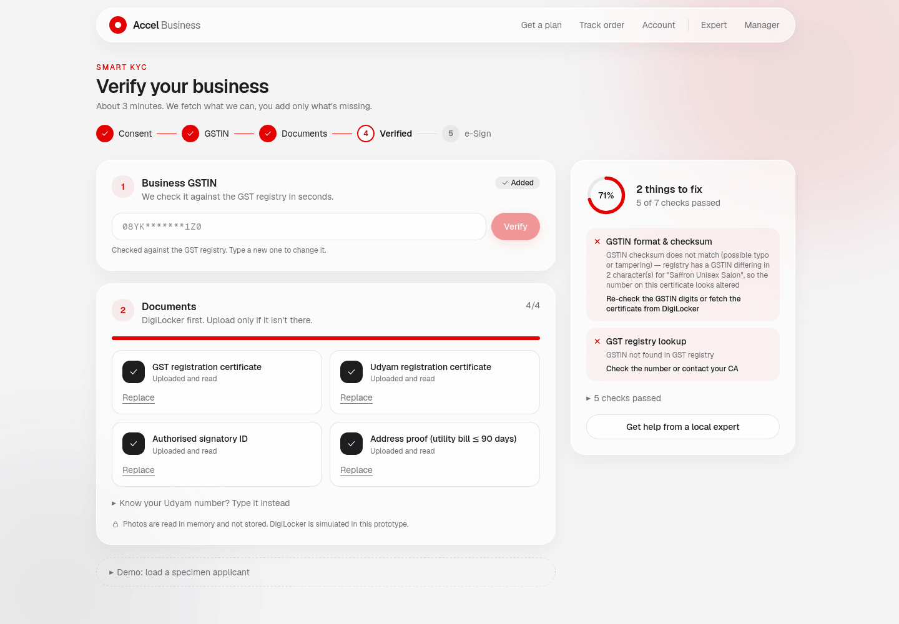 |

### Live tracker — no need to call
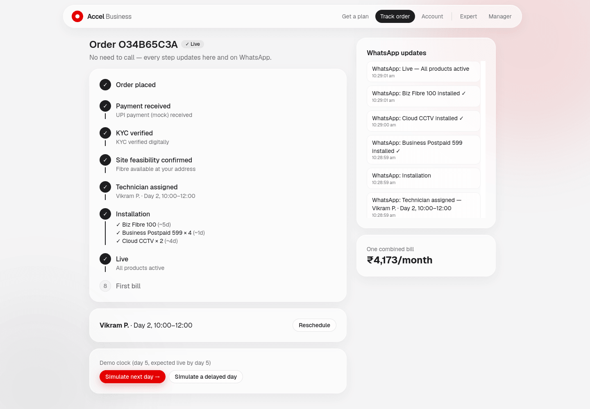

### Owner account and privacy center
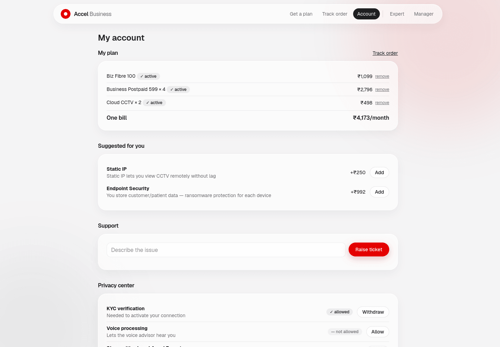

### Local Accel Expert console
Leads handed over by the AI, scored by our propensity model (logistic regression, AUC 0.729). Sample leads are real rows from the case dataset, tagged "Dataset".
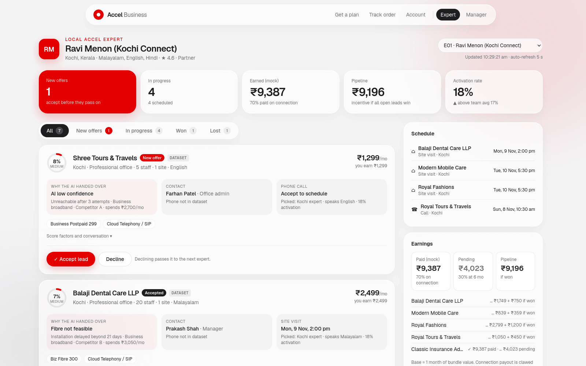

### Manager console

| Overview | Discount approvals |
|---|---|
| 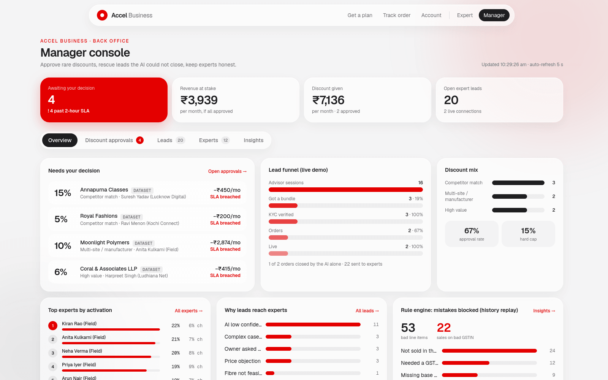 | 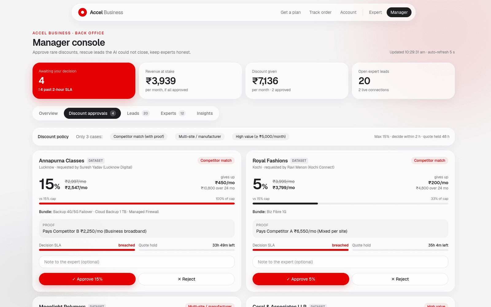 |

---

## Architecture

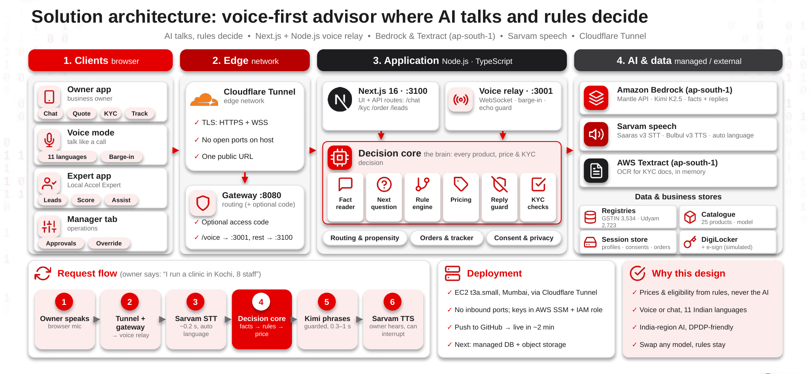

| Layer | Components |
|---|---|
| **Clients** | Browser: owner app, voice mode (16 kHz mic in, 24 kHz audio out), expert and manager consoles |
| **Edge** | Cloudflare Tunnel (HTTPS/WSS, no open ports) → gateway `:8080` (`/voice` → `:3001`, rest → `:3100`) |
| **Application** | Next.js 16 app + API on `:3100`; Node.js voice relay on `:3001` (WebSocket, barge-in, echo guard, sentence-by-sentence speech) |
| **Decision core** | Fact reader, next-question picker, rule engine, pricing, reply guard, KYC checks, routing & propensity, orders, consent |
| **AI services** | Amazon Bedrock (Mantle API, Kimi K2.5, ap-south-1), AWS Textract (ap-south-1), Sarvam Saaras v3 STT + Bulbul v3 TTS |
| **Data** | Case CSVs (catalogue, GSTIN/Udyam registries, leads), JSON session store, `propensity.json` |

**Deployment:** EC2 t3a.small spot in AWS Mumbai behind a named Cloudflare Tunnel. No inbound ports; AWS access via an IAM role; secrets in SSM Parameter Store. The server pulls `main` every minute and rebuilds (`deploy/`).

## Privacy and security

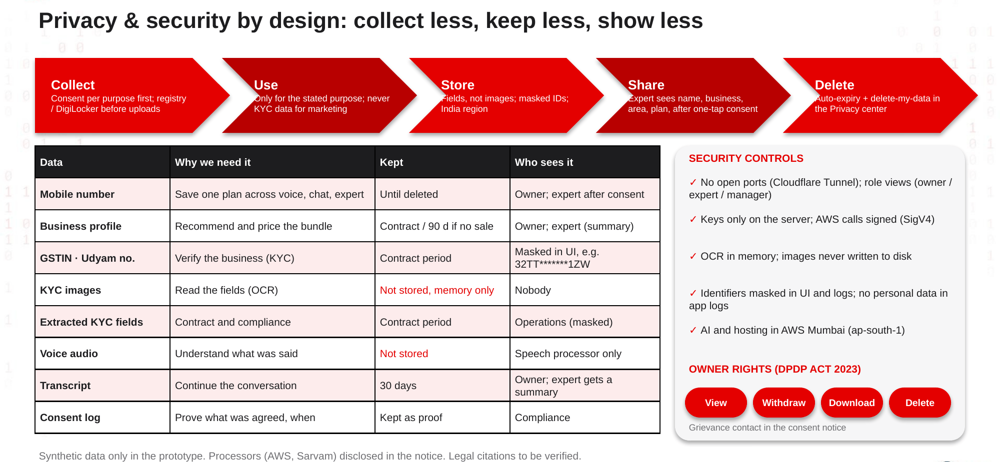

- Consent per purpose before KYC; plain-language notice (what, why, how long, rights).
- KYC images are read **in memory** by Textract and never stored; IDs are masked in the UI.
- Experts see contact details only after the owner consents to a hand-off.
- Owners can view, withdraw, download and delete their data in **My account**.
- AI and hosting in India (ap-south-1). Keys stay server-side; the repo has GitHub secret scanning and push protection on.

---

## Run locally

```bash
npm install
cp .env.example .env.local      # set SARVAM_API_KEY for voice
npm run dev                     # app on http://localhost:3100
npm run voice                   # voice relay on ws://localhost:3001 (second terminal)
npm run gateway                 # optional: single entry on :8080 (set GATEWAY_OPEN=1 to skip the access code)
```

AWS credentials come from the default chain (Bedrock and Textract in `ap-south-1`). Set `ADVISOR_MODE=guided` for a fully offline advisor with no LLM cost. `VOICE_PROVIDER=sarvam` enables multilingual voice; `nova` uses Amazon Nova Sonic instead.

## Checks (no AWS calls)

```bash
npm run typecheck
npm run check:engine   # replays the 368 real activations through the rule engine
npm run check:kyc      # runs Smart KYC on all 12 specimen applicants (cached OCR)
```

- `check:engine` reproduces the data finding: **53 rule-breaking line items** and **22 activations on cancelled/suspended GSTINs** the engine would have blocked.
- `check:kyc` blocks **5 of 12** specimen applicants: K01 (GSTIN cancelled, blank Udyam number), K05 (no Udyam certificate), K06 (GSTIN checksum fails: altered digits), K07 (legal name edited), K11 (bill older than 90 days). This is our own answer key, not the judges'.

## Project layout

| Path | What |
|---|---|
| `src/lib/engine.ts` | Eligibility, dependencies, recommendation, pricing, cheaper options, upsell |
| `src/lib/advisor.ts` | Fact reader, question picker, reply guard, guided fallback |
| `src/lib/llm.ts` | Bedrock Mantle client (SigV4-signed, OpenAI-compatible) |
| `src/lib/kyc.ts` | Textract parsing (watermark removal, deskew, OCR repair), checks, DigiLocker mock |
| `src/lib/routing.ts` | Propensity score, call/visit/nurture, expert ranking and assignment |
| `src/lib/orders.ts` | Order state machine and tracker |
| `src/lib/demo-leads.ts` | Sample expert leads and discount requests built from `smb_leads.csv` |
| `src/lib/store.ts` | JSON-file store shared by the app and the voice relay |
| `voice-server.mts` | Voice relay: Sarvam STT/TTS or Nova Sonic, barge-in, echo guard |
| `gateway.mts` | Single entry point; routes voice and app traffic |
| `deploy/` | EC2 bootstrap, systemd units, Cloudflare Tunnel config, auto-sync |
| `scripts/` | Engine replay, KYC self-check, OCR re-extract, propensity training |
| `data/` | Case CSVs, `propensity.json`, `ocr-cache.json` |
| `docs/` | Deck, demo video script, screenshots |

## Team

Team Ace · Leader: Jayant Batra
